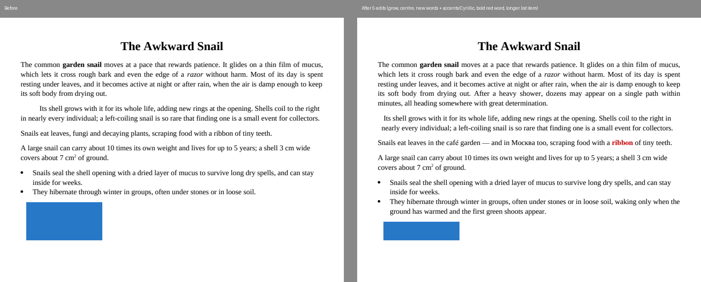

# PdfEngine

The PDF engine behind [SimplePDF Editor](https://github.com/AwkwardSnail/SimplePDFEditor), by [Awkward Snail](https://awkwardsnail.com.au): a .NET 8 library, with no user interface and no network access, that reads, edits, redraws and writes PDF files. It is built on [PDFium](https://pdfium.googlesource.com/pdfium/) (BSD/Apache licensed) through its native packages for Windows, Linux and macOS, and it is meant to be reused by other PDF projects.

What it is good at is changing a PDF without damaging the rest of the page: it rewrites a paragraph so that its words wrap again, moves, turns, restyles and deletes text, shapes and pictures, and where it can it does this in the page's own drawing instructions so that PDFium never has to write the page out and lose what it cannot model.

## Layout

- `src/PdfEditor.Core` - the engine. The namespaces are still `PdfEditor.*`, from before it was a project of its own; changing them would break every project that uses it, so they stay.
- `tests/PdfEditor.Core.Tests` - xUnit tests, with the files they read in `Fixtures/`.
- `PdfEngine.sln` - both of the above.

## Using it in another project

The simplest way is as a git submodule, which keeps the source in your repository's history and lets the project build from a clone:

```
git submodule add https://github.com/AwkwardSnail/PdfEngine.git engine
```

then, in your project file:

```xml
<ProjectReference Include="..\..\engine\src\PdfEditor.Core\PdfEditor.Core.csproj" />
```

Anyone who clones your project then needs `git clone --recurse-submodules` (or `git submodule update --init` afterwards). PDFium's native library comes in through NuGet; nothing else needs installing.

Things to know before relying on it:

- PDFium is not thread-safe, even across separate documents: use the library from one thread at a time.
- All coordinates are in points (1/72 inch) from the top-left of the page as displayed.
- `EditorSession` wraps a document with undo and redo (each change is kept as a copy of the file, up to 30 steps) and is what an editor with a window should use; `PdfDocument` is the plain engine.
- SimplePDF Editor is in the Microsoft Store, so the public API changes carefully: existing behaviour is not changed without a reason.
## Editing paragraphs with reflow

A PDF has no paragraphs, only characters placed at positions. `PdfEditor.Core` works the paragraphs out from where the characters sit, and can rewrite one so that its words wrap again, the way a word processor would.



```csharp
using var doc = PdfDocument.Open("in.pdf");

var paragraph = doc.FindParagraphAt(0, 120, 300);       // or doc.GetParagraphs(0)
Console.WriteLine($"{paragraph.Alignment}, {paragraph.LineCount} lines: {paragraph.Text}");

doc.ReplaceParagraphText(0, paragraph.Index, "New wording for the whole paragraph...");
doc.ReplaceInParagraph(0, paragraph.Index, start: 10, length: 5, "words");
doc.FormatParagraphText(0, paragraph.Index, 0, 4, new TextFormat { Bold = true, Color = new PdfColor(200, 0, 0) });
doc.SetParagraphAlignment(0, paragraph.Index, TextAlignment.Justify);
doc.ReplaceText("colour", "color");                     // whole document, every changed paragraph re-flows
doc.Save("out.pdf");
```

Paragraph indices are valid until the page changes, so read the paragraphs again after each edit.

**What is kept**

- Position, width, alignment (left, centre, right, justified), first-line indent, list-item hanging indent and line spacing.
- Formatting of the text that survives an edit: bold or italic words, colours, sizes, superscripts. New text takes the formatting around it.
- The original embedded fonts. Embedded fonts usually hold only the letters the document already uses; any other letter is drawn in a look-alike font (a standard PDF font of the same family, or an installed font for accents and other scripts), and the result says so.
- Everything else on the page. When the paragraph grows or shrinks, content below it in the same column (text, images, highlights and comments) moves with it; the other columns and the footer area stay put. On a page laid out in boxes or tables (a box or panel holds the paragraph and room below it, or a rule or shading reaches past the column over text that would not move with it), moving part of the page would tear the layout apart: there the paragraph changes in place, nothing else moves, and the result says so (`LeftInPlace`).
- The letter spacing the paragraph was set with. Publishers often set type a little tighter than its font does; the spacing is measured, used when wrapping, and written into the new text, so a rewritten paragraph is no looser than the text around it and does not grow a line for that reason. A paragraph that keeps its number of lines puts each line back exactly where it was.

**How paragraphs are found**

Lines are grouped into a paragraph when they share a text size and the page's usual line spacing, line up on the left, centre or right, and when each line was too full to take the next line's first word (a line with room to spare ended on purpose). Hyphenated words split across lines are joined back together.

**Limits**

- Detection is a judgement made from positions. Unusual layouts (tables, text in shapes, multi-column text drawn out of order) may be grouped differently from how they look.
- A forced line break inside a paragraph is drawn, but the PDF does not record it, so reading the page back gives one paragraph of two lines.
- Re-written lines keep the paragraph's overall letter spacing, but not the fine kerning between particular pairs of letters.
- Text that runs past the bottom of the page is reported (`RunsOffPage`), not moved to the next page.
- Right-to-left scripts, vertical text and text inside form XObjects are not re-flowed.

**Editing a page's instructions directly.** A page is a list of drawing instructions. PDFium reads them into a list of items and can write that list back only in part: it leaves out or flattens whatever it does not model (tiled patterns, gradients, soft masks, pictures written into the instructions, Type 3 text, CMYK and spot colours, letter spacing). So where it can, the editor does not have PDFium write the page at all. It reads the instructions itself (`Content/PageInstructions`), works out which of them draw the item being changed, and rewrites only those: an item is moved by boxing its own instructions in a shift, and removed by taking them out. Everything else on the page stays byte for byte as it was. This is used for moving, turning and deleting text, shapes, pictures, groups and gradients. Text needs one more step: pieces of text in a block share a writing position, each starting where the one before ended, so after a piece is moved or removed the position is set back to exactly where the original instruction would have left it (PDFium, which has measured the letters, is asked where the next piece starts). A move up or down a layer is done the same way: the item's instructions are taken out where they are and written again just past the item it is to pass, in a box of their own in which every setting the item was drawn with (coordinate space, clip, colours, line, font and text settings) is given afresh; the reader keeps those settings, as written, for every item. Where the new place is under a clip the item would be cut by, or see-through settings it never had, the item is put just outside that saved-state section instead. An item moved to where the clip it is drawn under would cut it is drawn just outside that section with its clip moved along. A shape's filling and line are changed by keeping its path as written and setting the colours and width just for it. A piece of text is recoloured by setting the colour before it and putting the old one back after it. Changes that put new text in place of old (rewriting a paragraph, find and replace, a change of font, size, bold or italic) are made in two steps: PDFium adds the new text, which it does without disturbing what is there; then one pass over the instructions removes the old text, shifts what lies below, and puts the new text where the old stood in the drawing and reading order. Text that itself clips, see-through colours and password-protected files still go the older way described next, as does anything the reader cannot follow on a given page.

**Keeping the rest of the page intact.** When an existing object changes, PDFium rewrites the page's original content and drops word and character spacing on the way, which would shift justified text elsewhere on the page. Before that happens, any text that depends on those settings is redrawn with each character pinned where it was. This also protects the editor's move, resize, delete and edit-text operations.

## Importing RTF

RTF documents (from Word, WordPad, LibreOffice and others) are laid out as PDF pages. The pages are ordinary editable PDF content, so imported paragraphs can be edited with reflow straight away.

```csharp
using var doc = PdfDocument.FromRtf(File.ReadAllBytes("notes.rtf"), out var result);
foreach (var warning in result.Warnings) Console.WriteLine(warning);   // what could not be brought across
doc.Save("notes.pdf");

existing.ImportRtf("appendix.rtf", index: 3);                         // or insert into a PDF that is open
```

**Brought across:** page size and margins; fonts, sizes, bold, italic, underline, strikethrough, colours, highlighting, superscript and subscript; alignment (including justified), indents, space before and after, line spacing, tab stops; bulleted and numbered lists; tables with borders; PNG and JPEG pictures; page and section breaks; Unicode and code-page text (including Cyrillic, Greek and other scripts).

**Left out (and reported in `Warnings`):** headers and footers, WMF/EMF pictures, tables inside tables (flattened). Footnotes, comments, fields' codes and drawing objects are skipped silently.

**Fonts.** By default the standard PDF fonts are used (Times, Helvetica, Courier, chosen to match each RTF font's family): small files that look the same everywhere. Text those fonts cannot show (for example Cyrillic or Greek) is drawn in a matching installed font, which is embedded. `new RtfImportOptions { EmbedFonts = true }` embeds the installed fonts the RTF names (Calibri, Georgia, ...) for a closer look; PDFium embeds whole font files, so this makes much larger PDFs.

Line breaks are worked out by this library, so they can differ slightly from the word processor's.

## Saving as RTF

`ExportRtf` writes the document for a word processor: its paragraphs with their fonts, sizes, bold, italic, colour and alignment, its pictures where they come in the text, and a new page (or a new section, where the page size changes) for each page. In the editor it is a file type in **Save As**; the PDF being edited stays as it is.

```csharp
byte[] rtf = doc.ExportRtf(out var result);   // result says how much was written and what was left out
File.WriteAllBytes("notes.rtf", rtf);
```

A PDF fixes where everything stands and RTF lets text run on, so exact positions, columns, drawn shapes, comments and highlights are not kept. Pictures are stored without loss (PNG), so a file with many pictures is large.

## What the engine does

- **Pages** – add blank pages, delete, reorder, rotate, import pages from another PDF.
- **Text** – add text (standard fonts, or an embedded TrueType font when characters need it), list the text runs on a page, edit a run in place, move or remove it.
- **Images** – add JPEG, PNG, BMP, GIF or TGA images, list, move and remove them.
- **Comments and highlights** – sticky-note comments, highlight/underline/strikeout/squiggly markup, search and "highlight every match".
- **Rendering** – render any page to BGRA pixels for display.

All coordinates are in points (1/72 inch) from the top-left of the page as displayed.

```csharp
using PdfEditor.Core;

using var doc = PdfDocument.Open("in.pdf");
doc.AddPage();                                        // blank A4 page at the end
doc.AddText(0, 72, 72, "Hello", new TextStyle { Size = 18, Bold = true });
doc.AddImage(0, File.ReadAllBytes("logo.png"), 72, 120, width: 150);
doc.HighlightText(0, "important");
doc.AddComment(0, 400, 72, "Please review", author: "Me");

var run = doc.FindTextRunAt(0, 100, 300);             // click-to-edit
if (run is not null) doc.EditText(0, run.ObjectIndex, "New wording");

doc.Save("out.pdf");
```

### Limits of text editing

A PDF stores text as separately positioned runs, not paragraphs. Editing a run changes its wording in place; the surrounding text does not reflow. When the run's embedded font lacks a needed character, a similar font is substituted and `EditText` reports it.

## Tests

```
dotnet test tests/PdfEditor.Core.Tests
```

The engine tests run on Windows, Linux and macOS.

The reflow and RTF tests read files in `tests/PdfEditor.Core.Tests/Fixtures`, made by `make_fixtures.py` there (python-docx, reportlab and LibreOffice): a Word-style document exported by LibreOffice with subset-embedded fonts, a two-column document justified with word spacing, and a Word document saved as RTF by LibreOffice.

`ConformanceTests` saves the result of every kind of edit and has [qpdf](https://qpdf.sourceforge.io/) check each file's structure against the PDF specification (ISO 32000-1). Install qpdf with `winget install QPDF.QPDF`; without it those tests pass with a note saying nothing was checked.

PDFium is not thread-safe, even across separate documents: use the library from one thread at a time.

## Licence

MIT (see `LICENSE`). Forks are welcome but may not use the Awkward Snail name.

The engine builds on work by others, each under its own licence:

- [PDFium](https://pdfium.googlesource.com/pdfium/) (BSD 3-Clause and Apache 2.0), through the `bblanchon.PDFium` packages. A program that ships it should carry PDFium's notices; SimplePDF Editor's `THIRD-PARTY-NOTICES.txt` is a working example, including the full Apache 2.0 text.
- [StbImageSharp](https://github.com/StbSharp/StbImageSharp) (public domain) for reading image files.